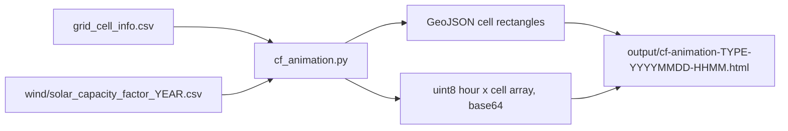

# Capacity factor map animation

A standalone script that turns one year of hourly wind or solar capacity factors (8760 frames) into a single self-contained HTML animation: a Plotly map of Canada with each grid cell drawn as a rectangle, coloured from pale blue (0) to deep red (1.0). Wind and solar are written to separate files.

## Format: web animation (single HTML file)

A web animation is simpler here than video:
- `ffmpeg` is not installed, and a video route would also need a mapping library (cartopy) plus ~8760 rendered frames (slow).
- `plotly` is already in the `viz` dependency group, and Plotly's `geo` layout draws Canada, provinces, and coastlines for free.
- The browser gives play/pause, speed control, a scrub slider, and hover readouts per cell.

Plotly's built-in `frames` mechanism will not scale (8760 frames x 2984 cells would be a JSON file of several hundred MB). Instead:
- Render one `choropleth` trace (one rectangle per cell) with the hour-1 values.
- Embed all values once, quantized to `uint8` (0-255 maps to CF 0-1, resolution about 0.004), base64-encoded: 8760 x 2984 bytes is about 26 MB raw, about 35 MB in the HTML. That loads fine in a browser.
- A small inline JS player decodes the array and calls `Plotly.restyle(div, {z: [...]})` for the current hour (see Player controls below).

## Player controls

- Opens paused on hour 1. Play/Pause button (Space bar toggles too).
- Speed: a dropdown of frames (hours) per second, default **1**: 0.5, 1, 2, 4, 8, 16. Changing it while playing takes effect on the next frame.
- Timing: each frame is scheduled with `setTimeout` only after the previous `Plotly.restyle` promise resolves, so slow renders lower the frame rate instead of queueing up frames. Playback stops at hour 8760 (no wrap).
- Year slider: `<input type="range" min=1 max=8760 step=1>` spanning the full width under the map, with month tick labels (Jan to Dec) under it. Dragging updates the map live (coalesced to one render per animation frame) and playback continues from the new position.
- Step buttons: back/forward 1 hour (also the Left/Right arrow keys) and back/forward 1 day (24 hours).
- Label: hour index plus the UTC interval that hour covers, for example `Hour 4387 - Jul 2 18:00-19:00 UTC`. CODERS hours are hour-ending in UTC (checked against the 2021 solar data: the Canada-wide mean peaks in hour-ending 19, around solar noon in central Canada). The 8760-hour year has no Feb 29.

## New module: `src/flux_match/viz/cf_animation.py`

- CLI via `argparse`: `--type {wind,solar}` (required), `--year` (default: 2021), `--out` (optional override).
- Load cells from `data/coders/grid_cell_info.csv` using `read_csv` from `src/flux_match/io.py` (`grid_cell`, `longitude`, `latitude`, `balancing_area`).
- Stream the hourly table with the existing `iter_hourly_capacity_factors(path, cells)` from `src/flux_match/grid_cell_rankings.py`. It already validates the header, row count (8760), and the [0, 1] range, and hard fails on bad data. Fill a preallocated `numpy` `uint8` array `(8760, n_cells)` with `round(cf * 255)`.
- Build cell rectangles: infer the grid spacing from the coordinates (expected 0.625 deg longitude by 0.5 deg latitude) and hard fail if any cell is not on that lattice, then make one GeoJSON `Polygon` per cell centered on its lon/lat.
- Figure: `go.Choropleth(geojson=..., locations=cell_ids, z=hour1, zmin=0, zmax=255, colorscale=pale blue to deep red, marker_line_width=0)`, colorbar ticks relabeled as 0.0-1.0. Hover shows cell id, balancing area, and CF. Layout `geo`: `scope="north america"`, `showcountries`, `showsubunits` (provinces), `showlakes`, `projection_type="conic conformal"`, `lataxis_range ~[41, 70]`, `lonaxis_range ~[-142, -52]`.
- Write HTML with `fig.to_html(include_plotlyjs=True, full_html=True, div_id="cfmap", post_script=PLAYER_JS)`, with the base64 data and controls injected into the page. Output filename follows the project convention: `output/cf-animation-<type>-<YYYYMMDD-HHMM>.html` using `TIMESTAMP_FORMAT` from `src/flux_match/paths.py`.
- Keep pure helpers (`cell_polygons`, `quantize`, `hour_label`) separate from I/O so they can be tested.

Note: Plotly's geo basemap (country and province outlines) is fetched from the Plotly CDN when the page opens, so viewing needs an internet connection.

## Wiring

- New batch script `bin/cf-anim`: `uv run --group viz python -m flux_match.viz.cf_animation "$@"`.
- Add a line to the Usage block in `README.md`: `bin/cf-anim --type wind|solar  # hourly capacity-factor map animation`.

## Tests: `tests/test_cf_animation.py`

Focus on the parts where subtle bugs are likely:
- `cell_polygons`: correct corners for a known cell, and a hard failure on an off-lattice cell.
- `quantize`: 0 maps to 0, 1 maps to 255, rounding at the midpoints.
- `hour_label`: hour 1 is `Jan 1 00:00-01:00 UTC`, hour 1417 is `Mar 1 00:00-01:00 UTC` (no Feb 29), hour 8760 is `Dec 31 23:00-24:00 UTC`. The JS label uses a month-start table generated by the same Python helper, so the two can't disagree.

## Verification

Run `bin/format` and `bin/test`, then generate the wind animation once and open it in the browser to check: default 1 fps playback, speed changes, slider scrubbing, step buttons, and that 16 fps stays responsive.
